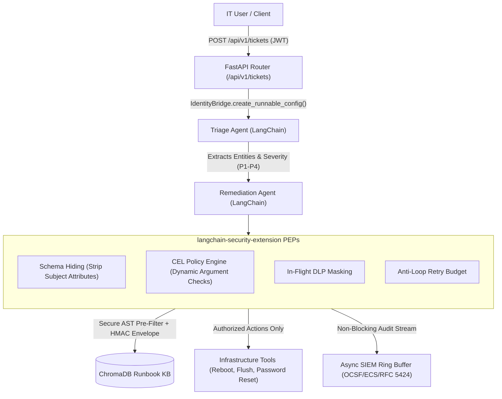

# Enterprise IT Incident & Service Desk Assistant

> **Reference Demonstrator Application for [langchain-security-extension](https://github.com/prashantdev/langchain-security-extension/)**

[](https://pypi.org/project/langchain-enterprise-incident-assistant/)
[](LICENSE)
[](https://github.com/prashantdev/langchain-security-extension/)
[](https://python.langchain.com/)

---

## 🎯 Purpose of This Demonstrator

This project is a realistic, production-style enterprise IT Incident & Service Desk Assistant built with **FastAPI**, **LangChain**, and **ChromaDB**. Its primary purpose is to serve as the official **reference demonstrator** for the **[langchain-security-extension](https://github.com/prashantdev/langchain-security-extension/)** library.

In modern enterprise architectures, agentic LLMs are given access to mutative operational tools (rebooting servers, clearing caches, resetting credentials, modifying firewall rules) and proprietary knowledge bases (incident runbooks, standard operating procedures). Without code-level security controls, these systems are vulnerable to:
- **Prompt Injection & Indirect Jailbreaks** that trick agents into executing unauthorized actions.
- **Cross-Tenant & Cross-Department Privilege Violations** when agents manipulate tool arguments across security boundaries.
- **Security Context Hallucination & Forgery** when agents invent or alter caller identity parameters exposed in tool schemas.
- **RAG Data Poisoning & Clearance Leaks** when unverified runbooks are ingested or retrieved across clearance tiers.
- **Runaway Agent Loops & Token Burn** when agents enter recursive retry loops following execution errors.
- **Sensitive Data & PII Exposure** in logs, telemetry, and SIEM feeds.

This repository demonstrates both the vulnerabilities of an unhardened baseline and their deterministic mitigation using the [`langchain-security-extension`](https://github.com/prashantdev/langchain-security-extension/) library.

---

## 🌿 Dual-Branch Demonstration Architecture

This repository uses a dual-branch structure to highlight the exact security improvements introduced by `langchain-security-extension`:

```
langchain-enterprise-incident-assistant/
│
├── master branch   ──► [Unhardened Baseline]
│                       Standard LangChain agents with perimeter auth (JWT).
│                       Vulnerable to prompt injection, parameter manipulation,
│                       RAG clearance leakage, and runaway agent loops.
│                       • Passes: basic-security-tests/
│                       • Fails:  internal-security-guardrail-tests/
│
└── secured3 branch ──► [Hardened Reference Implementation]
                        Hardened with langchain-security-extension.
                        Deterministic bytecode PEPs, CEL argument validation,
                        Schema Hiding, Secure RAG with HMAC envelopes,
                        in-flight DLP, and non-blocking SIEM telemetry.
                        • Passes: basic-security-tests/
                        • Passes: internal-security-guardrail-tests/ (31/31)
```

### 1. `master` Branch: Unhardened Baseline
- Implements standard perimeter security (JWT authentication, role verification on HTTP endpoints).
- Employs standard LangChain tools and RAG pipelines without code-level policy enforcement.
- Demonstrates how stochastic prompt instructions fail to prevent adversarial attacks, tool parameter tampering, and cross-department actions.
- **Test Results:** Passes `./run-security-suite.sh --suite basic`, but fails guardrail attack tests in `./run-security-suite.sh --suite guardrail`.

### 2. `secured3` Branch: Hardened with `langchain-security-extension`
- Integrates deterministic Policy Enforcement Points (PEPs) via `@secured_tool` decorators and `SecurityIdentity` propagation across LangChain `RunnableConfig`.
- Enforces Common Expression Language (CEL) argument constraints (e.g. departmental server ownership, clearance floors).
- Enforces **Schema Hiding**, stripping tenant IDs, roles, and subject identity fields from LLM-visible tool schemas.
- Implements **Secure RAG**: cryptographic HMAC-signed chunk envelopes, native vectorstore AST pre-filtering, and clearance matching.
- Protects against runaway agent loops with **anti-loop invocation retry budgets**.
- Sanitizes PII and credentials using **in-flight DLP scrubbing** before telemetry streams to SIEM over an asynchronous ring buffer.
- **Test Results:** Passes **both** `./run-security-suite.sh --suite basic` and all 31 vectors in `./run-security-suite.sh --suite guardrail`.

---

## 🛡️ Security Comparison Matrix

| Security Vector | Unhardened Baseline (`master`) | Hardened Demonstrator (`secured3`) with `langchain-security-extension` |
|---|---|---|
| **Tool Authorization** | Relies on LLM reasoning and perimeter HTTP roles | Deterministic, bytecode-level `@secured_tool` PEPs executed before tool code runs |
| **Tool Argument Validation** | Unchecked; agent can target any server or account | In-band **CEL Expressions** dynamically validate arguments against live caller attributes |
| **Identity & Context Integrity** | Security context passed in tool args, vulnerable to LLM forgery | **Schema Hiding** strips security parameters from tool schemas; identity travels in-band in `RunnableConfig` |
| **Token Cost & Denial** | Agent invokes tool, fails, burns tokens arguing with LLM | **Zero-Token Denial**: unauthorized calls are rejected at the front door before prompt serialization |
| **RAG Clearance & Multi-Tenancy** | Post-retrieval filtering; cross-tenant chunks leak in similarity search | **Native Vectorstore AST Pre-Filters** enforce tenant and clearance boundaries inside ChromaDB |
| **Knowledge Base Integrity** | Ingests unverified markdown files into vector store | **Cryptographic HMAC-Signed Envelopes** detect tampering and quarantine corrupted or elevated chunks |
| **Loop & Runaway Protection** | Vulnerable to infinite retry cycles on tool denial | **Invocation Retry Budgets & Circuit Breakers** terminate runaway loops deterministically |
| **Data Loss Prevention (DLP)** | Raw PII, credentials, and secrets logged in plain text | **In-Flight DLP Masking** scrubs PII, API tokens, and credentials from prompts, logs, and telemetry |
| **Auditing & SIEM** | Synchronous or unstructured application logging | High-performance, non-blocking async ring buffer streaming **OCSF, ECS, and RFC 5424** audit events |

---

## 🏗️ Assistant Architecture & Components

The demonstrator simulates a mission-critical Enterprise IT Service Desk:



### Key Modules:
- **`app/routers/tickets.py` & `auth.py`:** REST API endpoints for JWT authentication and ticket lifecycle handling.
- **`app/agents/triage_agent.py`:** Parses ticket requests, evaluates urgency/severity (P1–P4), extracts target entities (hostnames, accounts), and routes work.
- **`app/agents/remediation_agent.py`:** Executes incident runbooks and coordinates tool execution.
- **`app/agents/infrastructure_tools.py`:** Operational tool callables (`restart_server`, `flush_cache`, `reset_password`, `block_ip`).
- **`app/agents/knowledge_base_store.py`:** Vector store integration with ChromaDB, indexing IT incident SOPs and runbooks.
- **`app/security/security_integration.py` (on `secured3`):** Central bridge wiring `langchain-security-extension` adapters, identity propagation, secure tools, and audit streaming.

---

## 📦 Installation & Setup

### Prerequisites
- Python 3.9+ (Python 3.10–3.13 supported)
- Virtual environment (recommended: `.venv` in the repository root)

### 1. Install Dependencies

Using `pip` with `pyproject.toml`:

```bash
# Editable install of the assistant
pip install -e .

# With dev dependencies (pytest, pytest-cov)
pip install -e ".[dev]"
```

> [!NOTE]
> When running on the hardened `secured3` branch, the `langchain-security-extension` package must also be installed in the environment (e.g. `pip install -e ../langchain-security-extension`).

### 2. Configure Environment

Server properties can be inspected and configured in `config.properties`:

```properties
server.port=8080
auth.jwt.secret=supersecretkey-for-demonstrator-purposes
```

---

## 🚀 Running the Server

Start the embedded FastAPI server:

```bash
./startserver.sh
```

Or run via the CLI entrypoint installed by `pyproject.toml`:

```bash
incident-assistant
```

The server listens on `http://localhost:8080` (or the configured `server.port`).

---

## 🧪 Verification & Running Tests

### 1. Unit & Integration Tests

Run the full pytest suite:

```bash
./runtests.sh
```

### 2. Basic Security Tests

Runs 15 baseline security tests validating JWT authentication, role verification, and standard ticket workflows:

```bash
./run-security-suite.sh --suite basic
```

*Expected Result: Passes on both `master` and `secured3` branches.*

### 3. Internal Security Guardrail Tests

Runs 31 automated exploit and attack scripts evaluating guardrail robustness across:
- HMAC envelope tampering and unlabelled chunk quarantine policies (`01-07`)
- CEL parameter validation and departmental access boundaries (`08`, `11`, `14`)
- Hard abort enforcement and schema hiding verification (`09`, `12`)
- Policy brute-force and runaway retry loop termination (`10`, `29`)
- RAG clearance data leakage and vectorstore AST pre-filtering (`15-17`)
- PDP caching, circuit breakers, and state machine transitions (`18-22`)
- Prompt injection resistance and SIEM audit PII sanitization (`23-25`, `30`)
- Distributed tracing and sliding-window abuse throttling (`26-28`, `31`)

```bash
./run-security-suite.sh --suite guardrail
```

*Expected Result:*
- **`master` (Unhardened):** Fails because standard LLM agents lack deterministic PEPs.
- **`secured3` (Hardened):** All 31 tests pass with zero policy breaches.

### 4. Meta-Runner Options

```bash
# Run all test suites (basic + guardrail)
./run-security-suite.sh --all

# Run specific phases
./run-security-suite.sh --mvp       # MVP guardrail tests
./run-security-suite.sh --phase2    # Phase 2 guardrail tests
./run-security-suite.sh --phase3    # Phase 3 guardrail tests
```

---

## 📁 Repository Structure

```
langchain-enterprise-incident-assistant/
├── app/
│   ├── agents/
│   │   ├── triage_agent.py              # Incident classification & entity extraction
│   │   ├── remediation_agent.py         # Runbook execution & remediation agent
│   │   ├── infrastructure_tools.py      # Infrastructure tool operations
│   │   ├── knowledge_base_store.py      # ChromaDB runbook vector store
│   │   └── llm_factory.py               # Deterministic LLM factory
│   ├── routers/
│   │   ├── tickets.py                   # /api/v1/tickets router
│   │   └── auth.py                      # /api/v1/auth router
│   ├── security/
│   │   ├── auth.py                      # JWT verification & claims extraction
│   │   ├── models.py                    # SecurityIdentity & ticket schemas
│   │   └── security_integration.py      # (secured3) Adapter bridge for library
│   └── main.py                          # FastAPI application initialization
├── basic-security-tests/                # 15 baseline tests (JWT, basic RBAC)
├── internal-security-guardrail-tests/   # 31 exploit & guardrail tests
├── kb/                                  # Runbooks (Markdown SOPs) & test fixtures
├── performance-stress-tests/            # SIEM ring-buffer load & concurrency tests
├── tests/                               # Pytest unit and integration test suite
├── config.properties                    # Server configuration
├── pyproject.toml                       # Python package configuration & dependencies
├── runtests.sh                          # Pytest runner
├── run-security-suite.sh                # Automated security test runner
└── startserver.sh                       # Embedded server startup script
```

---

## 🔗 Related Resources

- **Core Library Repository:** [langchain-security-extension on GitHub](https://github.com/prashantdev/langchain-security-extension/)
- **Library Specifications:** Located in `library-specs/` in the parent workspace
- **LangChain Documentation:** [https://python.langchain.com/](https://python.langchain.com/)
- **FastAPI Documentation:** [https://fastapi.tiangolo.com/](https://fastapi.tiangolo.com/)
- **ChromaDB Documentation:** [https://docs.trychroma.com/](https://docs.trychroma.com/)

---

## 📜 License

This project is licensed under the Apache 2.0 License.
